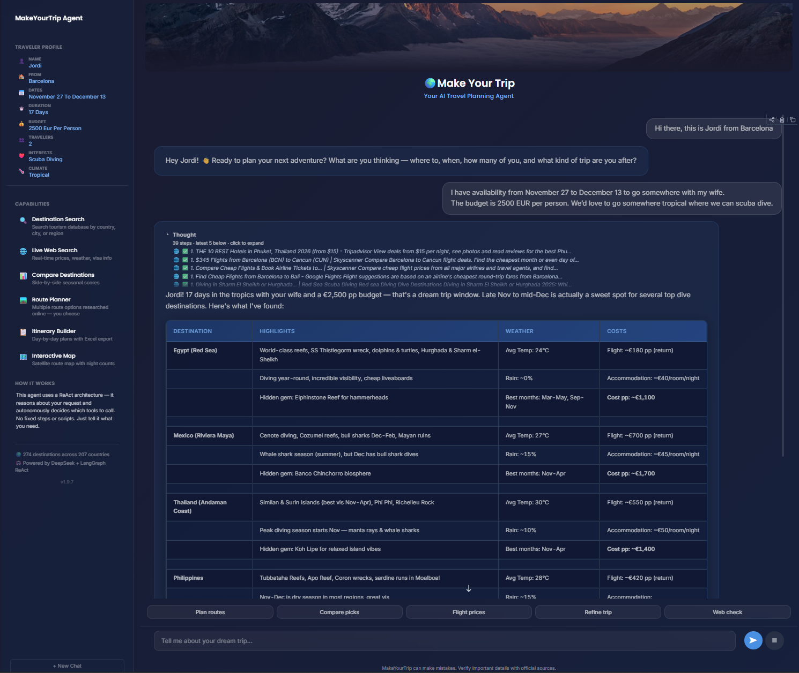
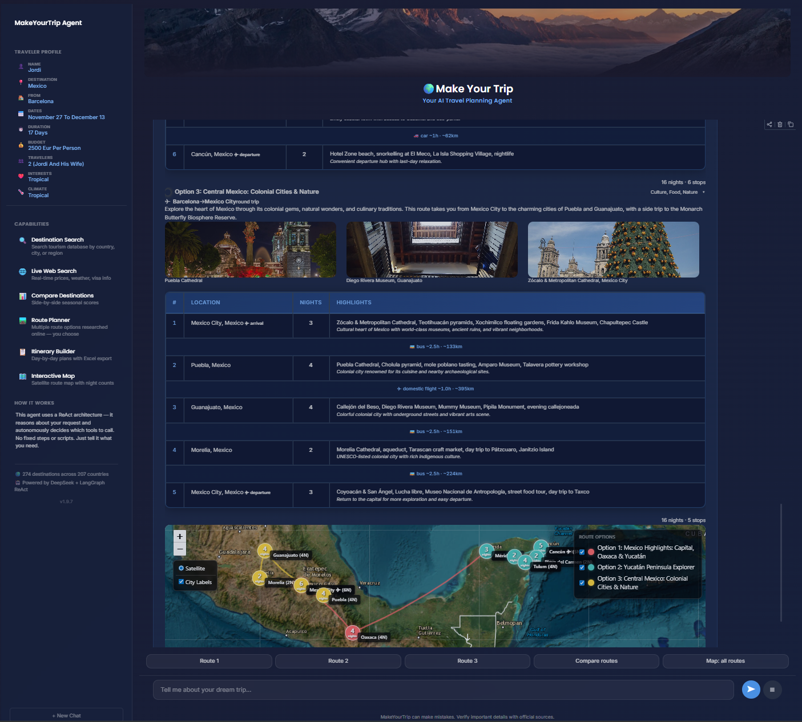
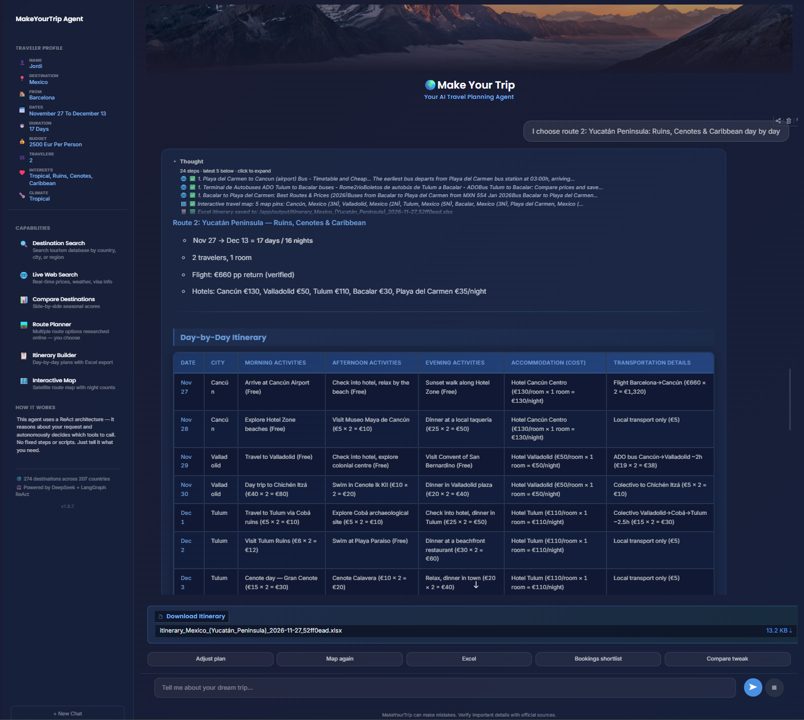
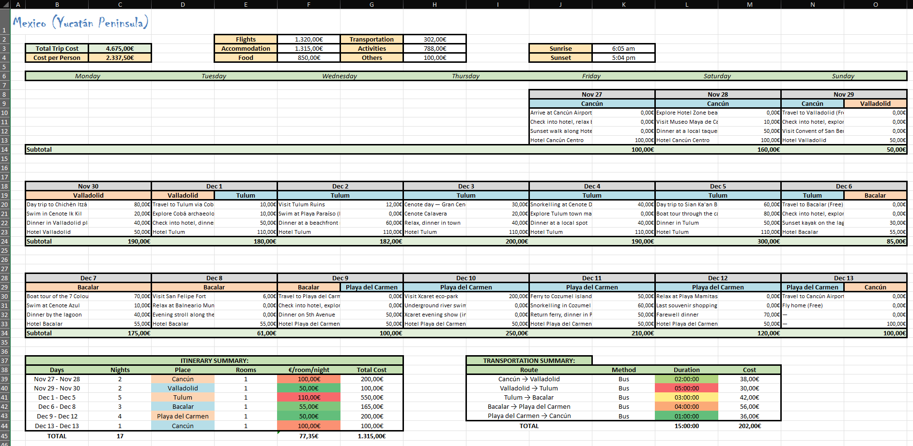
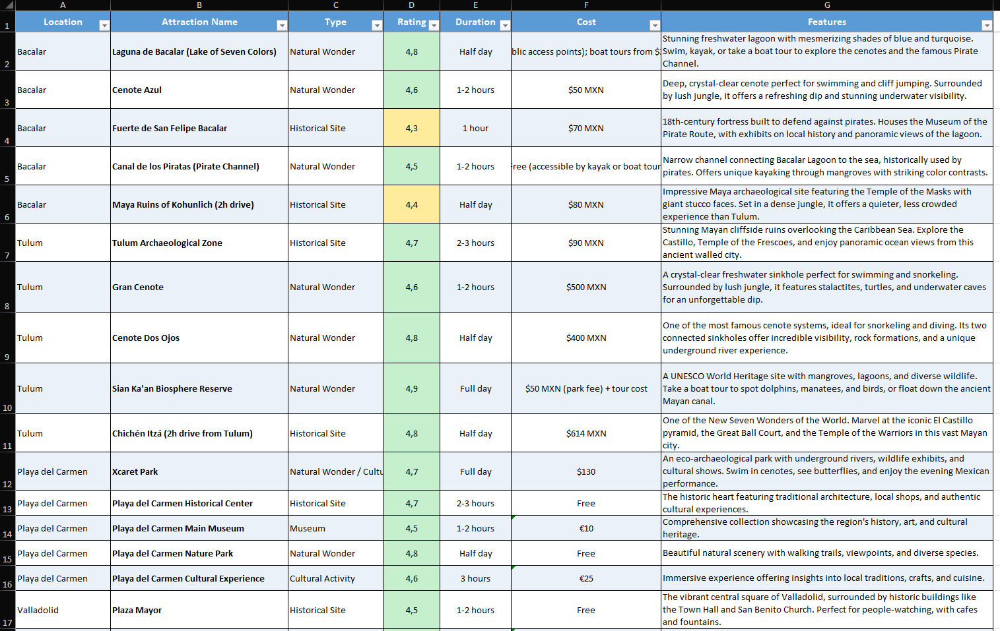
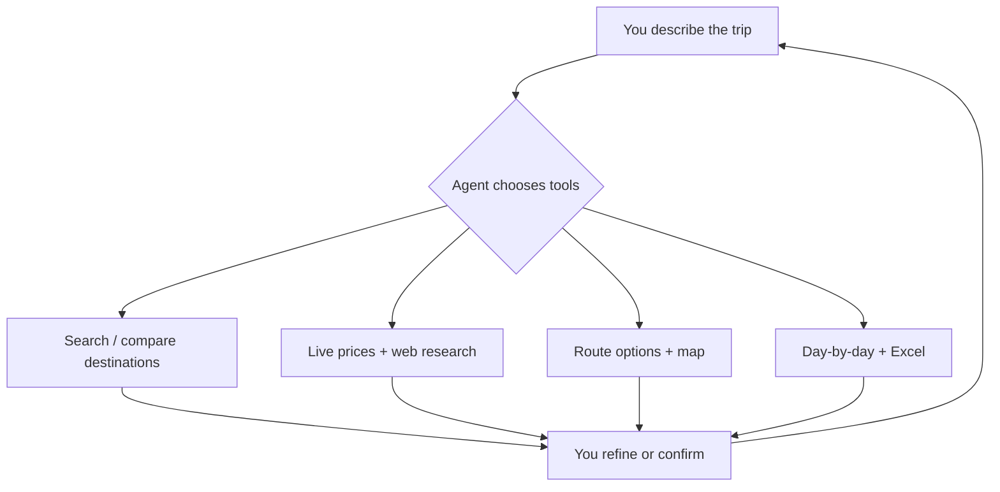

# MakeYourTrip

Plan a real trip by chatting. MakeYourTrip is an AI travel assistant that turns dates, budget, and preferences into destination picks, multi-stop routes, live price checks, day-by-day plans, maps, and Excel export.

**Try it live:** [https://toti97-makeyourtrip.hf.space/](https://toti97-makeyourtrip.hf.space/)

Questions, feedback, or errors → [jordisc@sole.cat](mailto:jordisc@sole.cat)

Built with **LangChain**, **LangGraph** (ReAct), **DeepSeek**, and a **Gradio** web UI.

---

## Strongest capabilities

- **Live MCP flight & hotel prices** — Dated fares and midrange nights with price bands
- **270+ scored destinations** — Search and compare across 200+ countries by travel month
- **Multi-stop route options** — 2–5 distinct itineraries with maps and night-tier planning
- **Day-by-day + Excel export** — Full daily plan plus a downloadable styled workbook
- **MCP web research** — Live lookup for weather, costs, visas, and trip facts
- **Streaming Gradio UI** — Chat planning with live traveler profile and tool progress

---

## Showcase

### Initial trip requirements

Share dates, budget, interests, and constraints. The chat gathers what it needs and reflects your preferences in the live traveler profile while the agent plans next steps.

### Route selection

After destinations are in focus, the assistant researches popular itineraries and presents distinct multi-stop route options. Interactive satellite maps and route cards help you choose how you move between stops.

### Day-by-day itinerary

You get structured daily plans (morning, afternoon, evening) with lodging and transport context, aligned to the route you confirmed.

### Excel export

Download a styled workbook: overview, day-by-day sheets, and cost / logistics summaries — ready to edit offline.

### Place-level todos

Granular checklists per stop help you track what still needs booking or confirmation before you travel.

---

## What you can do

### Discover and compare

- Search **270+** scored destinations across **200+** countries using monthly tourism suitability scores
- Compare shortlisted places for a specific travel month
- Pull live context (weather, visas, safety notes, typical costs) via MCP-backed web research

### Price the trip

- Dated **round-trip** and **one-way** flight estimates via MCP price tools
- Midrange **hotel** nightly rates with bands and confidence signals
- Optional cheaper-date sweeps on the same flight route
- Ground transport and daily food cost helpers for fuller budget context

### Plan the route

- Research real-world itinerary patterns, then synthesize **2–5** distinct multi-stop options
- Night tiers (anchor / secondary / transit), diversity filtering, and airport-aware start/end
- Interactive Folium satellite maps with night markers and curved route lines
- Transport-aware legs (sea gaps, long ground hops, self-drive preferences remembered in-session)

### Take it with you

- Day-by-day activities grounded in the route you picked
- Excel export with overview, calendar-style days, and accommodation / transport summaries
- Session-isolated maps and HTML so concurrent users stay separate

---

## How it works

There is **no fixed wizard**. One ReAct agent (LangGraph) decides **when** and **which** tools to call from the conversation — you stay in a natural chat the whole way.

Typical flow:

1. Describe dates, budget, interests, and constraints  
2. Review destination options and live price context  
3. Pick among 2–5 multi-stop routes on an interactive map  
4. Receive a day-by-day plan and download the Excel workbook  
5. Keep chatting to adjust nights, budget, or stops  

---

## Tech stack

| Area | Technology |
|------|------------|
| UI | Gradio (streaming chat) |
| Agent | LangChain + LangGraph (ReAct) |
| LLM | DeepSeek |
| Live research & prices | MCP integrations |
| Maps | Folium + Esri satellite tiles |
| Geocoding | Nominatim / OpenStreetMap |
| Data & export | Pandas + OpenPyXL |

---

## Try it

Use the hosted demo — no local setup required:

**[Open MakeYourTrip on Hugging Face →](https://toti97-makeyourtrip.hf.space/)**

If something looks wrong or you want early access / collaboration, email **jordisc@sole.cat**.

---

## Notes

- Prices and web facts are **planning estimates**, not a booking checkout. Always confirm with airlines, hotels, and official sources before you pay.
- Tourism scores and route templates are decision aids; the agent adapts them to your constraints in chat.
- This public page showcases the product. Screenshots live in [`MYT/`](MYT/).

## License

Personal and educational use unless otherwise stated by the repository owner.

## Acknowledgments

- DeepSeek for the LLM API  
- LangChain and LangGraph for agent tooling  
- Gradio for the web interface  
- OpenStreetMap / Nominatim and Esri tile providers via community libraries  

---

*To refresh screenshots, replace the PNGs in `MYT/` and keep the same filenames so the links above stay valid.*
